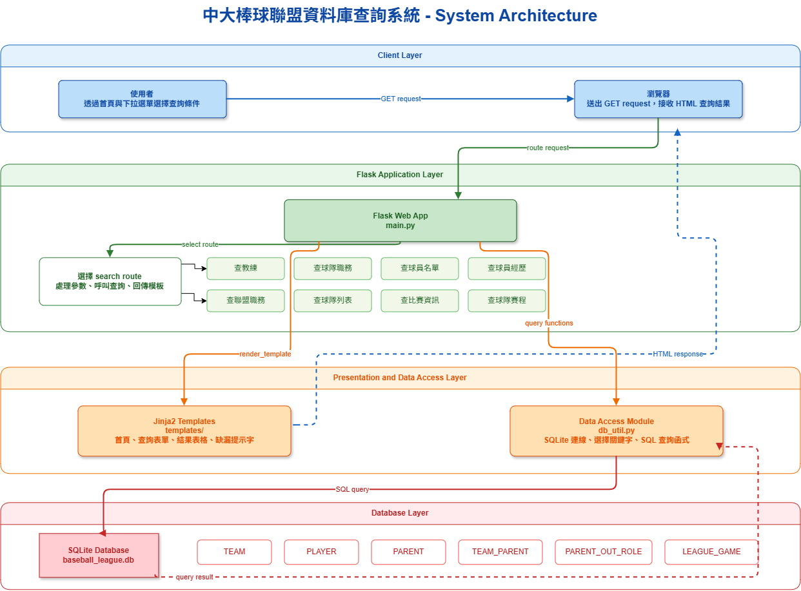
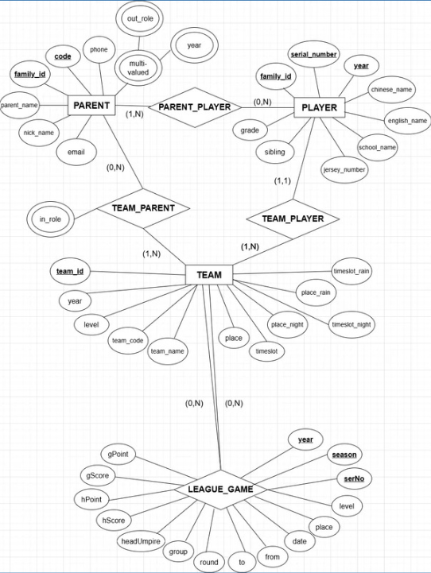
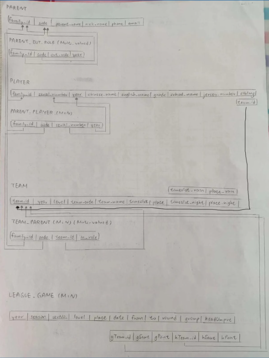

# 中大棒球聯盟資料庫查詢系統

## 專案結構

```text
.
├── main.py
├── db_util.py
├── baseball_league.db
├── database_schema.xlsx
├── templates/
│   ├── layout.html
│   ├── index.html
│   ├── coaches.html
│   ├── team_all_roles.html
│   ├── team_players.html
│   ├── player.html
│   ├── league_roles.html
│   ├── teams.html
│   ├── game.html
│   ├── team_games.html
│   └── team_detail.html
├── Relation_Picture/
│   ├── ER_Diagram.png
│   └── Relation_Database.png
├── 架構圖/
│   ├── System_Architecture.drawio
│   └── System_Architecture.png
├── requirements.txt
├── vercel.json
├── .gitignore
└── README.md
```

## 系統架構圖



### ER Diagram



### Relational Database Schema



## 技術架構

- Python
- Flask
- SQLite
- Jinja2
- Bootstrap 5
- HTML / CSS
- Vercel

## 功能特色

- 查詢球隊教練資料，包含隊教練、打擊教練與助理教練。
- 查詢球隊職務名單，呈現隊內家長或工作人員分工。
- 查詢球隊球員名單，包含中文姓名、英文姓名與年級。
- 查詢球員歷年所屬球隊經歷。
- 查詢聯盟職務人員。
- 查詢年度球隊列表，並可依層級篩選。
- 查詢單場比賽日期、地點、主客隊與時間。
- 查詢指定球隊在指定年度與賽季的賽程。
- 使用下拉選單降低輸入格式錯誤。
- 保留資料缺漏狀態顯示，例如球隊存在但目前沒有教練、球員或賽程資料。

## 本機執行方式

安裝套件：

```bash
pip install -r requirements.txt
```

啟動 Flask：

```bash
python main.py
```

開啟網站：

```text
http://127.0.0.1:8001/
```

## 部署說明

本專案可部署至 Vercel。資料庫使用固定的 SQLite 檔案，適合展示與查詢用途。

部署時需保留以下檔案：

```text
main.py
db_util.py
baseball_league.db
templates/
Relation_Picture/
架構圖/
requirements.txt
vercel.json
```

Vercel 會依照 `vercel.json` 將請求導向 `main.py` 中的 Flask app。
